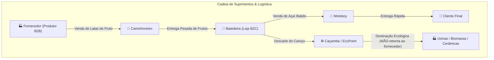
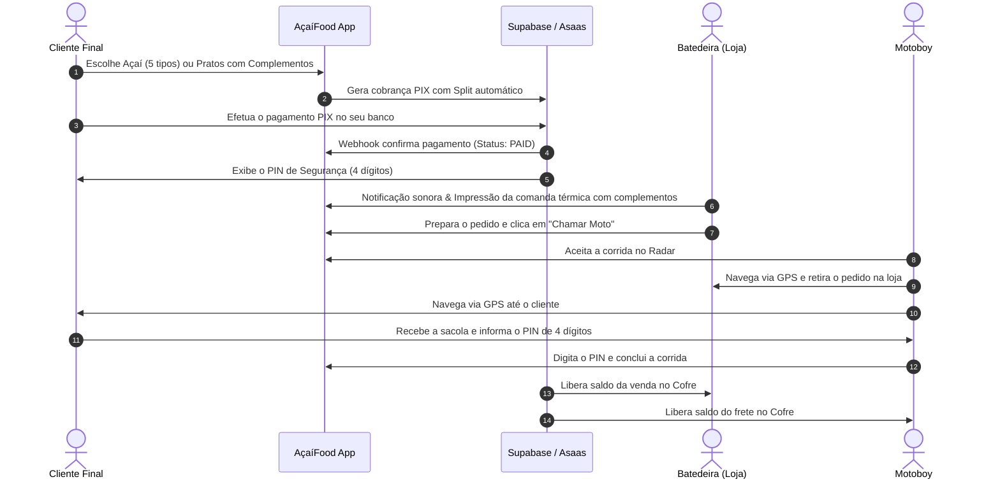
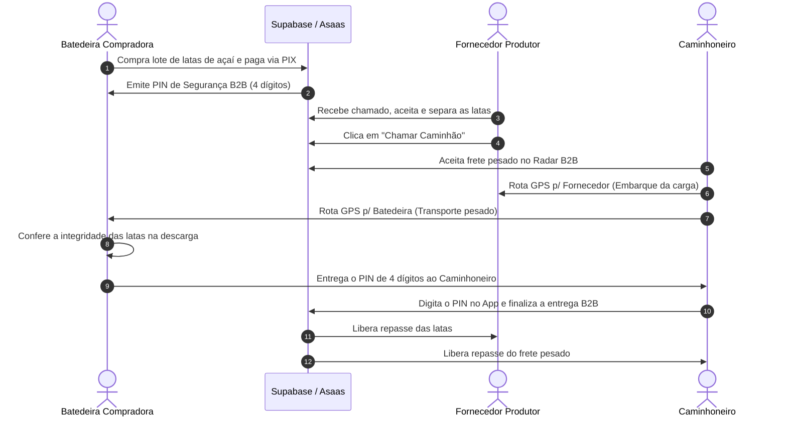
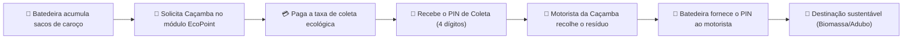

# 📘 Manual Mestre e Relatório Completo do Ecossistema AçaíFood
**Versão:** 2.0 • **Ano:** 2026  
**Plataforma Oficial:** [https://www.acaifood.app.br/](https://www.acaifood.app.br/)  
**Espelho de Produção:** [https://acai-food-mobile.vercel.app/](https://acai-food-mobile.vercel.app/)

---

## 📑 Sumário Executivo
1. [Visão Geral da Arquitetura](#1-visão-geral-da-arquitetura)
2. [Matriz de Perfis e Responsabilidades](#2-matriz-de-perfis-e-responsabilidades)
3. [Ciclo de Vida B2C: Consumidor Final & Batedeira](#3-ciclo-de-vida-b2c-consumidor-final--batedeira)
4. [Ciclo de Vida B2B: Batedeira & Fornecedor de Frutos](#4-ciclo-de-vida-b2b-batedeira--fornecedor-de-frutos)
5. [Ciclo de Vida da Logística Urbana (Motoboy)](#5-ciclo-de-vida-da-logística-urbana-motoboy)
6. [Ciclo de Vida do Transporte Pesado (Caminhão / Caçamba)](#6-ciclo-de-vida-do-transporte-pesado-caminhão--caçamba)
7. [Ciclo de Vida da Logística Reversa & EcoPoint (Sustentabilidade)](#7-ciclo-de-vida-da-logística-reversa--ecopoint-sustentabilidade)
8. [Mecanismo Universal de Segurança por PIN (4 Dígitos)](#8-mecanismo-universal-de-segurança-por-pin-4-dígitos)
9. [Sistema Financeiro: Checkout Asaas, Split Automático e Saques PIX](#9-sistema-financeiro-checkout-asaas-split-automático-e-saques-pix)
10. [Governança, Painel Administrativo e Auditoria de Segurança](#10-governança-painel-administrativo-e-auditoria-de-segurança)
11. [Sistema de Parceiros Afiliados (Indicações & Comissões)](#11-sistema-de-parceiros-afiliados-indicações--comissões)
12. [Sistema de Sócios Investidores (Profit Sharing)](#12-sistema-de-sócios-investidores-profit-sharing)
13. [Gestão Territorial de Vagas Fundador & Ativação Segura por Cidade](#13-gestão-territorial-de-vagas-fundador--ativação-segura-por-cidade)

---

## 1. Visão Geral da Arquitetura

O **AçaíFood** é uma plataforma integrada de tecnologia, logística e economia circular dedicada à cadeia de valor do açaí na Amazônia. A arquitetura une:

- **Frontend & App PWA:** Next.js 16 (App Router, Turbopack, React 19, Tailwind CSS, Lucide Icons).
- **Backend & Realtime:** Supabase (PostgreSQL com RLS, Realtime Subscriptions, RPCs Atômicas e Service Role).
- **Gateway de Pagamento & Split:** Asaas API v3 (Cobranças PIX com padrão EMV-Co BACEN, Webhooks e Liquidação de Subcontas).
- **Roteamento & Geoprocessamento:** Leaflet, OpenStreetMap, OSRM Routing e Web Geolocation API.

> **📌 Nota Importante de Cadeia de Valor:** O **Fornecedor/Produtor** é exclusivamente o vendedor do fruto fresco colhido e **NÃO recebe ou precisa receber o caroço de volta**. O caroço processado pela batedeira é recolhido por caminhões caçamba e encaminhado diretamente para indústrias de biomassa, olarias/cerâmicas, adubagem e ecopontos de reciclagem sustentável.

---

## 2. Matriz de Perfis e Responsabilidades

| Perfil | Rota do Painel | Atuação Principal |
| :--- | :--- | :--- |
| **Cliente** | `/` | Escolha de açaí, pagamento via Pix, rastreio de moto e validação de PIN na porta. |
| **Batedeira (Loja)** | `/parceiros/batedeira` | Venda de açaí batido, preparo com comanda térmica, compra B2B de latas e descarte de caroços. |
| **Fornecedor** | `/parceiros/fornecedor` | Venda no atacado de latas de açaí recém-colhidas para abastecimento de lojas. |
| **Motoboy** | `/parceiros/motoboy` | Entregas urbanas B2C com navegação GPS em 2 pernas (Retirada e Entrega) e validação de PIN. |
| **Caminhoneiro** | `/parceiros/caminhao` | Transporte pesado de latas (B2B) e coletas de resíduos (Caçambas/EcoPoint). |
| **Parceiro Afiliado** | `/parceiro/afiliado` | Divulgação da plataforma com link rastreável (`/r/[codigo]`), recebendo bônus por lojas/clientes e comissões. |
| **Sócio Investidor** | Admin (`/admin`) | Participação nos lucros líquidos mensais da plataforma com apuração e repasse via Pix. |
| **Administrador** | `/admin` | Configuração de taxas municipais, auditoria financeira, aprovação de contas e monitoramento geral. |

---

## 3. Ciclo de Vida B2C: Consumidor Final & Batedeira

### 🥣 Os 5 Tipos Oficiais de Açaí
O catálogo base de açaí é padronizado em 5 opções distintas por litro (1L):
1. **Açaí Popular:** Opção mais leve e acessível do cardápio.
2. **Açaí Médio:** O clássico equilíbrio paraense consumido diariamente.
3. **Açaí Grosso:** Polpa concentrada, de alta viscosidade e densidade.
4. **Açaí Branco:** Raridade botânica da Amazônia colhida de frutos verdes, com sabor amanteigado e suave.
5. **Açaí Congelado para Viagem (1 Litro):** Desenvolvido especificamente para transporte e viagens de longa distância. Já embalado e ultra-congelado para chegar intacto e gelado ao destino, sem necessidade de customização.

### 🍽️ Pratos Extras, Carnes & Sistema de Complementos
Para refeições e pratos complementares (Churrascos, Carnes, Peixes e Pratos Executivos):
- **Ponto da Carne:** Seleção exclusiva (obrigatória): *Ao ponto*, *Bem assado*, *Mal passado*.
- **Acompanhamentos:** Seleção múltipla com controle de limite configurável pela loja (ex: até 2 entre *Arroz branco*, *Baião de dois*, *Salada de maionese*, *Vinagrete* e *Farofa crocante*).
- **Observações do Prato:** Campo de texto livre para instruções ao chapeiro/cozinha (ex: *"sem cebola"*, *"vinagrete à parte"*).
- **Impressão Térmica (58mm/80mm):** O sistema imprime na comanda da cozinha os acompanhamentos e observações com recuo e destaque visual para evitar erros no preparo.

---

## 4. Ciclo de Vida B2B: Batedeira & Fornecedor de Frutos

As batedeiras necessitam de grandes volumes de matéria-prima (latas ou sacas de 60kg). O fluxo B2B automatiza o pedido, frete pesado e retenção do pagamento.

---

## 5. Ciclo de Vida da Logística Urbana (Motoboy)

O motoboy conta com uma interface projetada para agilidade no trânsito e máxima clareza:

1. **Radar em Tempo Real:** Alertas sonoros e visuais de novas corridas com distância exata em km e valor líquido a receber.
2. **Aceitação Atômica:** Utiliza a RPC PostgreSQL `accept_order_atomic`, impedindo que dois entregadores aceitem a mesma rota simultaneamente.
3. **Navegação em Duas Etapas:**
   - **Etapa 1 (🚀 GPS p/ Retirada):** Rota direta no Google Maps/Waze até a loja parceira.
   - **Etapa 2 (🏁 GPS p/ Cliente):** Rota direta com dados do cliente e ponto de referência.
4. **Chat Integrado:** Botão direto para conversar com a loja ou cliente em caso de dúvidas.
5. **Conferência de PIN:** Finalização obrigatória mediante código de 4 dígitos.

---

## 6. Ciclo de Vida do Transporte Pesado (Caminhão / Caçamba)

Desenvolvido para transportadores autônomos de carga pesada e operadores de caçamba:

- **Fretes B2B:** Transporte de grandes volumes de frutos entre produtores rurais, portos fluviais e batedeiras urbanas.
- **Tabela Diferenciada:** Tarifação por km rodado ou taxa fixa para caminhões, calculada com base no tipo de veículo cadastrado (Caminhão ou Caçamba).
- **Navegação OSRM:** Mapa com visualização da distância total e coordenadas de carga e descarga.

---

## 7. Ciclo de Vida da Logística Reversa & EcoPoint (Sustentabilidade)

Mais de 85% do fruto do açaí é composto pelo caroço. O módulo **EcoPoint** resolve o passivo ambiental das cidades:

---

## 8. Mecanismo Universal de Segurança por PIN (4 Dígitos)

O protocolo de PIN é o núcleo anti-fraude e de conformidade do AçaíFood em todas as operações:

| Tipo de Transação | Quem gera e possui o PIN? | Quem digita e valida o PIN? | O que acontece após a validação? |
| :--- | :--- | :--- | :--- |
| **B2C (Venda de Açaí)** | 👤 Cliente Residencial | 🛵 Motoboy | Confirma a entrega física, protege contra cancelamento e **libera o saldo na carteira da batedeira e do motoboy**. |
| **B2B (Lote de Frutos)** | 🏪 Batedeira Compradora | 🚚 Caminhoneiro | Confirma a conferência do lote e **libera o valor das latas para o produtor e o frete pesado**. |
| **EcoPoint (Resíduos)** | 🏪 Batedeira Solicitante | 🚛 Motorista de Caçamba | Confirma a coleta física do caroço e **liquida o frete da caçamba**. |

> **🔐 Regra de Proteção em Trânsito:** No momento do pagamento pelo cliente, o entregador ainda não foi alocado ou pode haver troca/cancelamento durante o trajeto. Portanto, os repasses financeiros aos parceiros **só entram no saldo disponível de saque após a validação presencial do PIN de 4 dígitos** (`RECEIVED`). Isso garante que o valor seja creditado exclusivamente a quem finalizou com sucesso a entrega.

---

## 9. Sistema Financeiro: Checkout Asaas, Split Automático e Liquidação em 2 Tempos (Opção 2)
 
 ### 💳 Fluxo de Liquidação Assíncrona em 2 Tempos (Contrato Asaas BaaS)
 Em estrito cumprimento às **Cláusulas 2.1, 6.3 e 6.4 do contrato de Banking as a Service (BaaS) do Asaas**, os valores repassados devem transitar pela subconta de pagamento do parceiro antes de serem enviados à sua conta bancária externa:

 1. **Idempotência de Pagamento:** Cada pedido gera uma cobrança com chave única (`externalReference = orderId`), impedindo duplicidade no checkout PIX.
 2. **Acúmulo Seguro na Conta Master:** O pagamento do cliente entra na conta Master (Eletromecânica Baia Ltda) e fica protegido durante todo o preparo e despacho.
 3. **Saldo Estrito Pós-PIN:** O saldo para saque só é liberado ao parceiro após a validação presencial do PIN de 4 dígitos (`RECEIVED` / `DELIVERED`).
 4. **Tempo 1 (Master ➔ Subconta Asaas):**
    - Quando o parceiro solicita saque e o administrador aprova no painel, a conta Master efetua a transferência do valor integral solicitado para a subconta Asaas (`walletId`) do parceiro.
    - A solicitação assume o status `PROCESSING` (`Em Processamento (Subconta)`).
    - **O Pix externo NÃO é disparado simultaneamente**, eliminando o conflito de fila que causava o estorno (`INTERNAL_TRANSFER_REVERSAL`) no Asaas.
 5. **Tempo 2 (Subconta ➔ Conta Bancária Pix do Parceiro):**
    - Assim que a transferência interna é liquidada no Asaas (`status: DONE`), notificada via Webhook (`/api/asaas/transfer-webhook`) ou detectada pelo sincronizador contínuo (`/api/admin/withdrawals/reconcile`):
    - O sistema acessa a subconta via sua chave de API dedicada (`partner_secrets`).
    - Desconta a taxa de transferência Pix do Asaas de **R$ 0,99** (Opção 1 de tarifa: o parceiro arca com o custo do Pix).
    - Envia o valor líquido via Pix diretamente para a conta bancária do titular (mesmo CPF/CNPJ).
    - A subconta zera perfeitamente, o saque atinge status `PAGO`, os pedidos vinculados são baixados (`payout_driver_done` / `payout_seller_done = true`) e o extrato financeiro é registrado.
 6. **Mesma Titularidade Obrigatória (Resoluções BCB nº 1/2020 e nº 80/2021):**
    - Todas as contas bancárias de destino Pix devem pertencer rigorosamente ao mesmo CPF ou CNPJ cadastrado, sem exceções.
 
 ---
 
 ## 10. Governança, Painel Administrativo e Auditoria de Segurança
 
 ### 🛡️ Blindagem de Segurança e Fonte Única da Verdade (PostgreSQL)
 - **Banco de Dados como Fonte Única:** As tabelas `orders` (`payout_seller_done`, `payout_driver_done`), `withdrawal_requests` (`PENDENTE`, `PAGO`), `splits` e `partner_ledger` garantem a consistência matemática absoluta entre todas as telas.
 - **Sincronização 3-Telas em Tempo Real:** 
   - Ao liquidar repasses na **Aba Usuários** (`pagarParceiro`/`pagarTodosParceiros`), na **Aba Cidades** (`Liquidar`) ou na **Central de Saques** (`handleApprove`), o sistema atualiza atomicamente o banco e zera os valores pendentes em todas as visões simultaneamente.
 - **Trava Atômica de Saque:** O endpoint de aprovação (`/api/admin/withdrawals/[id]/approve`) altera o status para `APROVADO` de forma transacional, impossibilitando saques duplicados ou concorrentes.
 - **Autenticação Criptográfica de APIs:** Todos os endpoints exigem validação rigorosa de **JWT Supabase** (`Bearer <token>`) ou autorização administrativa (`authorizeRequest`), eliminando vulnerabilidades de escalada de privilégios.
 - **Row Level Security (RLS):** As tabelas `orders`, `users`, `withdrawal_requests`, `admin_balances` e `platform_settings` possuem políticas ativas no PostgreSQL, garantindo isolamento total entre usuários.

---

## 11. Sistema de Parceiros Afiliados (Indicações & Comissões)

- **Cadastro sob Convite Exclusivo:** O administrador gera convites nominais (`/api/affiliates/invite`) com bônus por loja, bônus por cliente, % de comissão e meses de vigência (link com token expirável em 7 dias).
- **Link Rastreável `/r/[codigo]`:** Quando um usuário acessa o link, o sistema grava um cookie de 7 dias e exibe a tela de boas-vindas. No cadastro de nova loja ou cliente, o `affiliate_id` é vinculado em `users.referred_by_affiliate`.
- **Ledger de Comissões por Pedido:** Cada pedido concluído via indicação gera um registro na tabela `affiliate_commission_ledger`, separando a comissão devida ao afiliado e atualizando o total ganho via RPC `increment_affiliate_earned`.
- **Painel do Afiliado (`/parceiro/afiliado`):** Interface intuitiva onde o promotor monitora cliques, bônus, comissões em tempo real, manual de operação e solicita saques para sua chave Pix cadastrada ou subconta Asaas.
- **Fluxo Financeiro de Pagamento:**
  - *Origem:* Os ganhos do afiliado saem exclusivamente da comissão de intermediação retida pela plataforma (AçaíFood), sem onerar batedeiras ou entregadores.
  - *Solicitação:* O afiliado solicita saque no painel quando acumular R$ 20,00 ou mais, informando sua chave Pix (mesmo titular CPF/CNPJ).
  - *Liquidação:* O administrador aprova o saque na aba **💰 Financeiro → Saques**, transfere o Pix e dá baixa com status `PAGO`.

---

## 12. Sistema de Sócios Investidores (Profit Sharing)

- **Trava de Segurança (Máximo 3 Sócios Ativos):** Trigger PostgreSQL `trg_max_profit_partners` impede mais de 3 sócios investidores ativos simultaneamente no banco de dados.
- **Apuração Mensal de Faturamento Líquido (`/api/profit-sharing/calculate`):**
  - Receita Bruta = Comissões de Vendas B2C/B2B + Comissões de Frete + Taxas de Ativação de Lojas.
  - Custos Deduzidos = Tarifas Asaas + Comissões de Afiliados Pagas + Outros Custos Operacionais Auditados.
  - Faturamento Líquido = Receita Bruta − Custos Operacionais.
- **Repasse Individual via Pix:** Cada sócio recebe o valor correspondente à sua cota percentual (`share_pct`), com status auditado (`pending`, `paid`) e registro de comprovante/recibo.

---

## 13. Gestão Territorial de Vagas Fundador & Ativação Segura por Cidade

O AçaíFood adota uma governança de expansão territorial desenhada para incentivar a adesão pioneira sem abrir mão da sustentabilidade financeira e da integridade da base de dados:

### 🌟 1. Separação de Cotas: Batedeiras (Lojas) vs Motoboys (Entregadores)
- **Independência Operacional:** A plataforma separa rigorosamente a contabilidade de vagas entre estabelecimentos comerciais (`storeFreeQuota`) e profissionais de entrega (`courierFreeQuota`).
- **Valores Pós-Cota Customizáveis:** As taxas de ativação Pix cobradas após o preenchimento das vagas gratuitas são configuráveis de forma distinta (`storeActivationFee` e `courierActivationFee`).

### 🏙️ 2. Parametrização Granular por Praça / Cidade (`cityConfigs`)
- **Configuração Global vs. Sobrescreve por Município:** A plataforma possui valores padrão globais, mas permite que o administrador defina cotas e taxas exclusivas para qualquer cidade através do botão **`⚙️ Ajustar`** na tabela de praças do Painel Admin (`/admin → Parceiros → Ativações`).
- **Selo de Identificação:** Cidades com parametrização própria exibem o distintivo **`✨ Personalizada`** e dispõem de um botão **`Restaurar Padrão`** para retorno instantâneo às diretrizes da plataforma.
- **Filtro Rápido:** A visão do painel administrativo permite auditar vagas ocupadas e restantes no consolidado ou filtrar por praça individual (ex: Belém, Afuá, Portel).

### 🔒 3. Blindagem Anti-Cadastro Fantasma (Fluxo Pix Pré-Criação de Conta)
- **Validação de Pagamento Prévia:** Para usuários que tentam se cadastrar após o esgotamento da cota gratuita da sua cidade, o sistema gera a cobrança Pix via Asaas (com CPF/CNPJ de referência `ACTIVATE_CPF_...`).
- **Bloqueio de Criação sem Pagamento:** O botão de finalização e criação do registro no banco de dados só é liberado após a confirmação do Pix em tempo real via webhook Asaas / polling seguro, eliminando contas fantasmas na base.

---

### 🌐 Endereços Oficiais
- **Produção Web:** [https://www.acaifood.app.br/](https://www.acaifood.app.br/)
- **Deploy Vercel:** [https://acai-food-mobile.vercel.app/](https://acai-food-mobile.vercel.app/)

